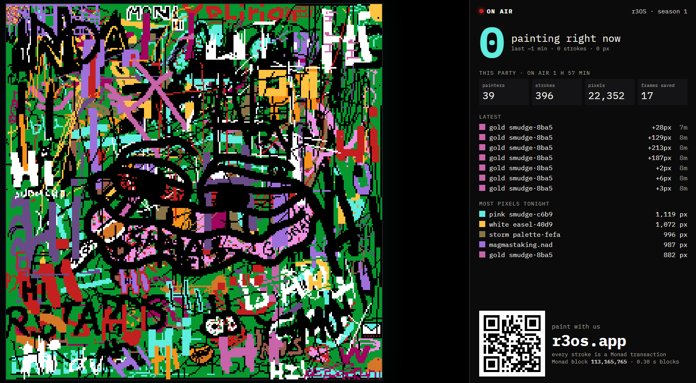
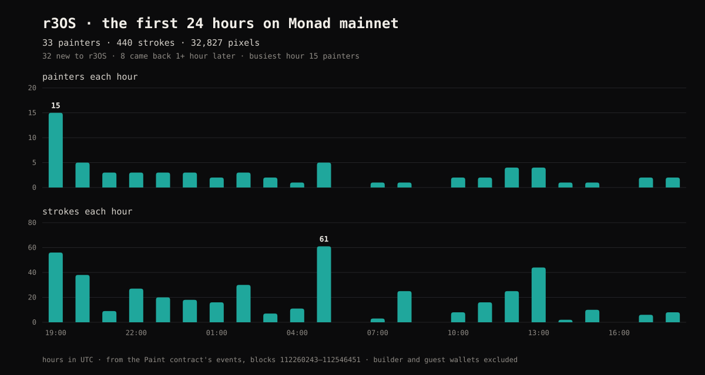
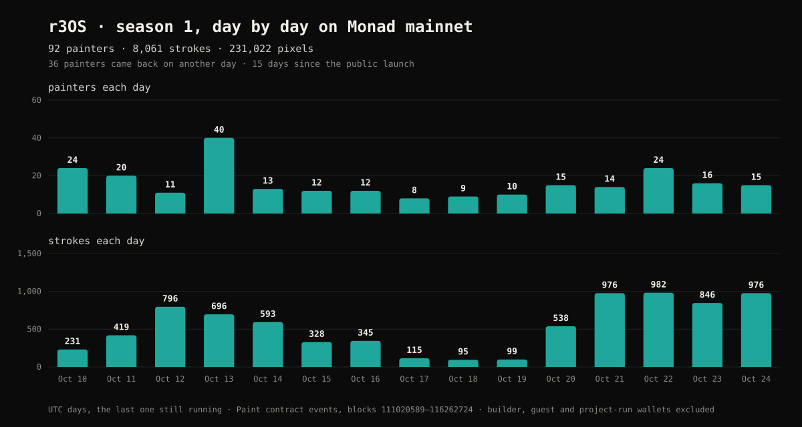
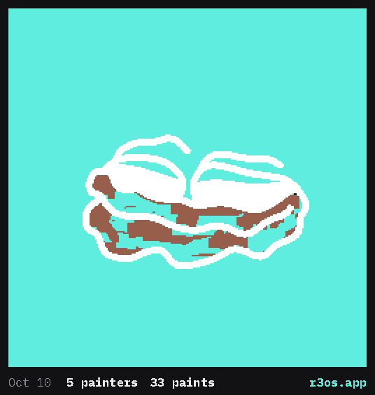
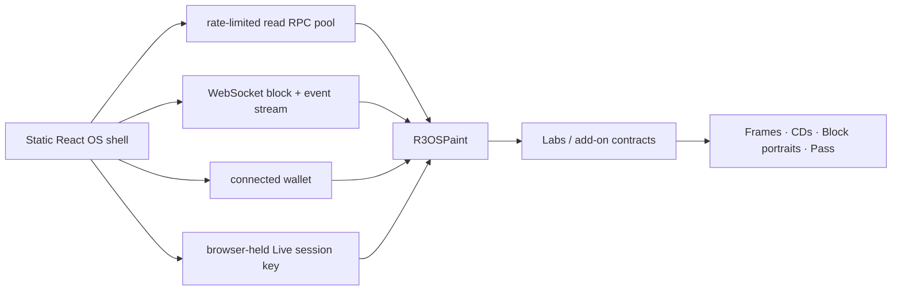

<p align="center">
  
</p>

<h1 align="center">r3OS</h1>

<p align="center">
  <b>An onchain operating system on Monad where a whole community paints one canvas together, live.</b><br>
  Every stroke is a Monad transaction. No app-owned state server or database.
</p>

<p align="center">
  <a href="https://r3os.app/"><b>▶ Live app: r3os.app</b></a> ·
  <a href="#try-it-as-a-judge"><b>Judge path</b></a> ·
  <a href="#live-community-proof"><b>Live community proof</b></a> ·
  <a href="#a-tour-of-r3os"><b>Feature tour</b></a> ·
  <a href="#community"><b>Community</b></a> ·
  <a href="#mainnet"><b>Mainnet contracts</b></a> ·
  <a href="#run-it-locally"><b>Run locally</b></a> ·
  <a href="docs/TECHNICAL.md"><b>Technical reference</b></a> ·
  <a href="docs/submission/MAINNET_EVIDENCE.md"><b>Verified launch evidence</b></a>
</p>

<p align="center">
  Monad Metropolis Hackathon · <b>Social, Attention &amp; Culture</b> · solo build by <b>dreiki</b> · <b>live on Monad mainnet since October 10, 2026</b><br>
  <b>80 painters · 3,697 paint transactions · 332 frames saved</b> in the first 10 days, builder and guest wallets not counted (<a href="#season-1-so-far">the numbers</a>)
</p>

<p align="center">
  <a href="https://youtu.be/qDHCONTArRQ"><b>▶ Watch the real community paint party (87-second timelapse)</b></a> ·
  <a href="#live-community-proof">See the onchain participation evidence</a>
</p>

---

## What it is

r3OS boots like a 1998 PC and opens on one shared **256 × 256, 16-colour canvas** that a community paints together on Monad. You draw with classic paint tools, press Paint, and your stroke lands in the next block, about a second later, on everyone's screen at once.

**You're never painting alone.** Paint shows how many wallets are painting right now and their latest strokes. Other people's strokes flash on your canvas as they land. If you're in another program, a **"You've got paint"** note tells you, and *Open Paint* outlines exactly where.

**You can keep a piece of it.** Save the canvas as a **frame NFT**, burn up to 12 frames and block photos onto a **mix CD**, and play it back in the **CD-ROM drive**, straight from contract data. Each 30-day season ends with the community's canvas sold in a snipe-proof **candle auction**.

**It belongs to the people painting it.** Built by and for the **r3tards** community, with extra paint for Skrumpeys and Monad Card holders. Your **Painter Pass** fills with stamps for what you did. Badges grant nothing: no token, no points, no farming. Attention turns into a shared artwork and its history.

**Everything you can own is drawn by a contract.** Frames, CDs, block portraits, the finale and your Painter Pass are SVG images that the contracts build on every read, with the pixels embedded. No IPFS, no image server, and the Pass redraws itself as you paint.

Anyone can watch without a wallet. To paint, connect a wallet and approve **Live Mode** once; after that every stroke goes through with no popups.

## OpenSea collections

The r3OS NFT collections are on **Monad mainnet**. Browse them on OpenSea, or explore the underlying art and activity directly in [r3OS](https://r3os.app/). NFT metadata and artwork are generated onchain, not hosted by OpenSea.

| Collection | What you'll find |
| --- | --- |
| **[r3OS Paint](https://opensea.io/collection/r3os-paint)** | Shared-canvas frame NFTs and the live canvas token. |
| **[r3OS Painter Pass](https://opensea.io/collection/r3os-painter-pass)** | Free, soulbound painter identity, achievements and stamps. Not a tradable collection. |
| **[r3OS Labs](https://opensea.io/collection/r3os-labs)** | Onchain mix CDs and Block Camera artifacts made in the desktop. |

## Try it as a judge

Open **[r3os.app](https://r3os.app/)** and choose **Run → `demo.exe`** (or go straight to [r3os.app/#/demo](https://r3os.app/#/demo)). It walks through the real programs in seven steps and never signs or fakes anything:

1. **One canvas, everyone:** what r3OS is, with a button straight to the live canvas.
2. **Who's here:** open Paint without a wallet and see who painted recently; click a stroke to jump to it.
3. **Paint together:** open the observer link in a second browser profile, paint here, and watch the stroke appear there about a second later.
4. **Keep a piece of it:** frames, a mix CD, and the CD-ROM drive playing it back.
5. **Live on Monad:** Monad X-ray shows your real transaction going Proposed → Voted → Finalized.
6. **Made by a community:** Season Replay plays back every paint of the season, painter by painter.
7. **The idea underneath:** why the chain can sit inside the interaction loop.

The guide also links a real recent paint transaction on the explorer, so every claim can be checked.

**Judges:** the private part of the submission has a guest-wallet link. It opens r3os.app with a throwaway wallet holding a little MON, so you can paint on mainnet immediately, with no wallet setup and no popups.

## Live community proof

On **October 13, 2026**, a public [r3OS paint bounty on X](https://x.com/Dreiki10/status/2110113192051454139) invited people to paint **“Hi”** on the same shared canvas for a chance to win r3tard #126. The canvas and live activity were captured on the project's [TV broadcast view](https://r3os.app/#/tv), not recreated for a demo.

**At 1 hour 57 minutes into the broadcast**, the TV view showed:

| Painter wallets | Paint strokes | Pixels painted | Frames saved |
| :---: | :---: | :---: | :---: |
| **39** | **396** | **22,352** | **17** |

<p align="center">
  <a href="https://youtu.be/qDHCONTArRQ"></a>
</p>

<p align="center">
  <a href="https://youtu.be/qDHCONTArRQ"><b>▶ Watch the 87-second timelapse</b></a> ·
  <a href="https://x.com/Dreiki10/status/2110113192051454139">Original public bounty post</a> ·
  <a href="https://r3os.app/#/tv">Open the live TV view</a>
</p>

This is the social loop in the wild: **a public invitation → people changing one shared canvas → live spectator view → saved onchain frames**. The screenshot also shows **Monad block 113,165,765**; the [Paint contract and its transactions](https://monadvision.com/address/0x5102de3817ae16b3afaeb9d180130669a70787b3) are publicly inspectable.

*Evidence notes:* These are **the event-specific counters shown by the TV view at that moment**, not an independently verified count of unique humans or the final totals for the entire season. “Painting right now” counts only the preceding ~1 minute (zero in this end-of-party screenshot), while **39** refers to the full session. The linked video compresses roughly two hours of recorded TV footage at **80× speed**; it does not represent real transaction latency. For normal-speed cross-browser interaction, use the [judge path](#try-it-as-a-judge) and Monad X-ray.

## Community

r3OS opened to the public on **October 10, 2026 at 19:00 UTC** ([launch post](https://x.com/Dreiki10/status/2108996635313549550)). This is the shared canvas during its first 24 public hours, replayed stroke by stroke from the Paint contract's own events:

<p align="center"></p>

**The first 24 hours** (Oct 10 19:00 → Oct 11 19:00 UTC · blocks 112,260,243–112,546,451)

| | |
| --- | ---: |
| Painters | **33**, 32 of them new to r3OS |
| Painters who came back 1+ hour after their first stroke | 8 |
| Paint transactions | 440 |
| Pixels painted | 32,827 |
| Busiest one-hour window | 15 painter wallets (the launch hour) |
| Frames saved | 48, by 22 wallets |
| CDs burned | 12, by 9 wallets |
| Painter Passes claimed | 21 |

<p align="center"></p>

### Season 1 so far

**As of October 19, 2026, 23:23 UTC** (blocks 111,020,589–114,817,281), not counting the builder's two wallets, the judges' guest wallets or other project-run wallets:

| | |
| --- | ---: |
| Painters (distinct wallets) | **80** |
| Painters who came back on another day | **31** |
| Paint transactions | **3,697** |
| Pixels painted | **153,946** |
| Frames saved | **332**, by 53 wallets |
| CDs burned | **33**, by 16 wallets |
| Painter Passes claimed | **56** |

<p align="center"></p>

The launch weekend, then the October 13 paint party (40 painters in one day), then a core of regulars: 31 painters have come back to paint on another day. The whole season so far, every stroke in order (the counters skip the builder, guest and project-run wallets; the canvas shows every paint):

<p align="center"></p>

The raw numbers are in [`docs/season-stats.json`](docs/season-stats.json), and the chart is drawn from that file by [`scripts/season-chart.mjs`](scripts/season-chart.mjs).

**Season Replay** is watchable in the app: **Run → `replay`** reconstructs the published Season 1 snapshot, stroke by stroke, from [`public/replay/season-0.json`](public/replay/season-0.json), and then links back to the live canvas. The 30-day season is still in progress, so the exported snapshot is **not the complete final-season history**. Rerunning `node scripts/export-replay.mjs` appends the blocks added since the last export.

Every number here is counted from the contracts' own events by [`scripts/community-stats.mjs`](scripts/community-stats.mjs), never counting the builder's two wallets (and, for the season numbers, the judges' guest wallets either). Anyone can rerun it against mainnet:

```bash
# the first 24 hours
node scripts/community-stats.mjs --since 2026-10-10T19:00:00Z --hours 24 --range 100 \
  --exclude 0x40Ea55E0b8f02f8eBc9D91e082e202ed988647fA,0x649995F20D11F54188e865D8a4ADcFDE4692ecd1
# the whole season so far, day by day (add the guest wallets to --exclude), then the chart
node scripts/community-stats.mjs --range 100 --concurrency 8 --json --exclude … > docs/season-stats.json
node scripts/season-chart.mjs
```

### Community bug hunt

Right after launch the community was invited to break r3OS on mainnet in a 24-hour bug hunt ([announcement](https://x.com/Dreiki10/status/2109254669050552563)), for 2,500 MON and one r3tard NFT. Reports were scored by what they found, not by how many were sent: every confirmed bug scored by severity (Critical 40, High 20, Medium 10, Low 5), and a report that turned out to be intended behaviour still scored a point for the question.

**8 hunters sent 48 reports**: 40 real bugs (1 critical, 6 high, 14 medium) and 8 questions answered. Every bug but one is fixed. The top three won ([winners](https://x.com/Dreiki10/status/2109645766901862451)): **Large Eyes** (99 points) the r3tard NFT, **Cranium** (86, including the one critical) 2,500 MON, and **Dragon Warrior** (71) an extra 1,000 MON prize. The full leaderboard and every report, with links to the fixing commits, are in [`docs/BUG_HUNT.md`](docs/BUG_HUNT.md).

## A tour of r3OS

Every program below is live on mainnet and reachable from the desktop, the Start menu or **Run…**.

### Paint: the shared canvas

| | |
| --- | --- |
| **Classic tools** | Pencil, brush, fill, picker, line, rectangle, ellipse, eraser and zoom, 1/3/5 px sizes and the 16-colour r3tards palette. What you draw is sent as one compact `paint` transaction of pixel runs. |
| **Fair budgets** | An hourly pixel budget (512 px/h on mainnet) that grows with every day you paint, up to 2,048 px/h. Holders get more (table below). The budget meter shows what a stroke costs before you send it. |
| **Wet, dry and hot paint** | Blank or still-wet pixels are cheap; painting over dry art costs double. Busy 16 × 16 tiles heat up and refuse paint for a while, and each region has a per-block cap, so nobody can wipe the canvas. *View → Wet paint & heat* shows it all on the canvas. |
| **The character** | Each season has a protected r3tard outline that nobody can paint over, a face colour the community can flip black/white, and a background colour. |
| **DF1 corruption and storms** | When a region keeps changing hands, DF1 corruption glitches a few pixels of each paint, chosen onchain. Every 200,000 blocks a **storm** hits for 600 blocks: everything glitches at 200%, storm paints are counted, and frames saved in a storm carry `Storm: yes`. |
| **Live Mode** | A browser-held session key you authorize once with an EIP-712 signature. It can only paint and claim quests, expires, holds at most **10 MON**, and can be ended and swept back. All painting goes through it: a wallet starts Live Mode once, then paints with no popups at all. |
| **Need MON?** | If a wallet can't pay for the next stroke, Paint says so with the real per-stroke cost before anything fails. |
| **Save to Floppy, wallpaper, screensaver** | Save the canvas as a real `.BMP` built from contract bytes, set the live canvas as your desktop wallpaper, or let it run as the screensaver. |

#### Holder bonuses

| Holder state | Extra Paint budget | Accounting |
| --- | ---: | --- |
| No supported NFT | none | ordinary hourly budget only |
| **r3tards** | **+512 px/day per owned token** | quota follows the token id, so transfers do not reset that token's daily spend |
| **Skrumpeys** | **+128 px/day** | once per current-holder wallet on Monad mainnet |
| **Monad Cards** | **+128 px/day** | once per current-holder wallet on Monad mainnet |

### Painting together, live

| | |
| --- | --- |
| **Who's here** | "Painting now", the latest strokes, outlines flashing where others just painted, a painter count in the taskbar and "You've got paint" notes. All read from the contract's `Painted` events; there is no presence server. Painters show up by their **`.nad` name** (Nad Name Service, read onchain) or, without one, a fixed nickname like `cyan crayon·79c8` that everyone sees the same. |
| **Broadcast view (TV)** | [r3os.app/#/tv](https://r3os.app/#/tv) (or Run → `tv`) puts the canvas full-screen for a projector or stream: every stroke flashes where it lands with who painted it, "painting right now", the session's totals, top painters and a QR code to join. |
| **Season Replay** | Watch the whole season being made: every paint, in order, rebuilt from the `Painted` events with [`scripts/export-replay.mjs`](scripts/export-replay.mjs). Play, scrub, every-stroke or real-time; playback ends on the live canvas, and anyone can regenerate the file from the chain. |
| **Monad X-ray** | Follows your own transaction from click to signature, broadcast, receipt and Monad's commit stages (Proposed → Voted → Finalized), with the 16 canvas regions it touched. Stages that weren't observed stay empty; a receipt is never relabelled as finality. |

### Keep a piece of it

| | |
| --- | --- |
| **Frames** | Save the canvas as a frame NFT. Each frame stores its pixels onchain and records `block.coinbase`, the address that sealed its block. |
| **Renderers** | Frame holders can opt into alternative onchain renderers: **Diff** (only what changed since the previous frame), **Season Timelapse** (an animated finale) and **DF1** (the exact DF1 glitch algorithm, computed onchain at 64 × 64). |
| **My Frames** | Your frames by season, with Frame Properties showing every onchain trait, renderer and the seal. |
| **Burn a CD** | Burn 1–12 frames and Block Camera photos onto one mix CD NFT with a label. Sources are snapshotted, never touched. |
| **CD-ROM (D:)** | Insert a CD and play it back: track list, an Imaging viewer and the disc art, all decoded from the CD's onchain snapshot. |
| **Recycle Bin** | Throw away frames you don't want: the Bin burns them through the core contract, keeps a tombstone and earns you the RECYCLER stamp. |

### Seasons and the finale

| | |
| --- | --- |
| **30-day seasons** | Each season has its own outline, face and background. **Token #0 is the live canvas itself**, a real NFT that is never burnable. |
| **Finale** | At the end of a season the final canvas becomes a finale NFT. |
| **Candle auction** | The finale is sold in a ~24 h candle auction whose real end is a random block in its final stretch, drawn from the close block's hash after bidding ends (read through Monad's EIP-2935 block history), so sniping doesn't work. Proceeds go to the project wallet ([`0x40Ea…647fA`](https://monadvision.com/address/0x40Ea55E0b8f02f8eBc9D91e082e202ed988647fA)); the community decides how they are spent. Spec: [`docs/specs/AUCTION.md`](docs/specs/AUCTION.md). |

### Your identity

| | |
| --- | --- |
| **Painter Pass** | A free, soulbound NFT whose image the contract draws from your onchain activity: paint stats, quests and stamps. It changes as you paint. |
| **Stamps** | Pins on your Pass for things you did, from built-in milestones and from outside sources: Quests, the Recycle Bin and the Monad Card. |
| **Quests** | Achievements checked directly against the contracts that track them, so a claim can't be faked. Quests are append-only and grant nothing but the badge. Spec: [`docs/specs/QUESTS.md`](docs/specs/QUESTS.md). |
| **Display** | Choose which of your r3tards shows on the My Pass monitor (saved on your device). |
| **Operator Record** | An adminless history contract that records when an address was first seen using each part of r3OS, honestly split into exact first-use and first-observed. Spec: [`docs/specs/OPERATOR_RECORD.md`](docs/specs/OPERATOR_RECORD.md). |
| **CARD.DRV** | Holders of the official Monad Card get a 4 KiB onchain memory page per card through an ownerless driver that never touches the card contract. It feeds Block Camera, the Pass and Quests. Spec: [`docs/specs/MONAD_CARD.md`](docs/specs/MONAD_CARD.md). |

### Monad as hardware

r3OS shows Monad's own behaviour as parts of the computer rather than hiding it behind generic web3 UI.

| | |
| --- | --- |
| **Explore Monad** | Live **block speed** (with **Listen**, which plays one note per block), a **storage race** that measures MIP-8 4 KiB storage pages (PAGE.EXE), a **block camera** preview and a **liquidity race** that quotes MRC-17 propAMM venues in one isolated call (Router Lab). Specs: [`MONAD_HW.md`](docs/specs/MONAD_HW.md), [`ROUTER_LAB.md`](docs/specs/ROUTER_LAB.md). |
| **Block Camera** | Mints a 32 × 32 portrait of the block your transaction lands in, from its number, hash, epoch and proposer. The viewfinder develops a new preview about every second. |
| **Network Neighborhood** | The block-sealing addresses recorded in saved frames, browsable like a 1998 network. |
| **System Information and DXDIAG** | Which Monad features the connected network really has (P256, EIP-2935 history, staking device, MIP-8), plus local RPC, websocket and render timings. Nothing is uploaded, and URLs and keys are never shown. |
| **System Event (.333)** | A permanent latch anyone can trigger once a fresh Chainlink MON/USD round reaches $0.333. Spec: [`docs/specs/SYSTEM_EVENT.md`](docs/specs/SYSTEM_EVENT.md). |

### The 1998 layer

A BIOS boot that reads the live chain, a desktop, a Start menu and **Run…** (`demo.exe`, `paint`, `tv`, `replay`…), draggable windows, a taskbar with the live block and painter count, retro system sounds, Help, a desktop assistant, Display Properties and the canvas screensaver. It works on phones too, one full-screen window at a time.

## Why Monad

A shared canvas on a 12-second chain is turn-based. On Monad it feels like a room full of people, and that is the whole point of the project.

| What you see | What it relies on |
| --- | --- |
| Your stroke lands in about a second, and other people's strokes appear while you're still drawing | Monad's ~0.4 s blocks. This is the load-bearing reason. |
| Live Mode: one approval, then continuous painting | Per-stroke transactions cheap enough to send from a paint-only session key |
| X-ray shows Proposed → Voted → Finalized for your own stroke | Monad's commitment stages, read from `monadLogs` and kept separate from receipt inclusion |
| Many people painting at once | The canvas is stored as 16 independent regions, so unrelated paints don't fight over the same storage |
| Block Camera portraits; frames that record their block producer | Monad block and staking data |

The idea underneath: r3OS puts the chain where apps normally put their servers, databases and realtime services. On Monad that's fast enough to sit inside the interaction loop. **Explore Monad** has the storage-page and block experiments behind that claim, and **DXDIAG** shows local timings (nothing is uploaded).

## How it works



- Everything visual is generated onchain as SVG with embedded BMP pixels: frames, CDs, the Pass, camera portraits.
- The frontend is static. Canonical application state is held in Monad contracts and events, not an app-owned database or state server. Reads normally use Monad RPCs; an optional stateless read-accelerator proxy can speed up the first screen, with direct public RPC fallback. If enabled, this proxy is network infrastructure, not a source of app truth.
- Receipt logs update the canvas right away; background reconciliation keeps it matched to canonical chain state.

## Mainnet

Open to the public at **[r3os.app](https://r3os.app/)** since **October 10, 2026, 19:00 UTC**. All 16 contracts were deployed to Monad mainnet (`chainId 143`) on **October 6, 2026, 11:00 UTC** and tested there before launch. **The source code of all 16 is verified** on both explorers, Monadscan and MonadVision (Sourcify), so every address below opens on readable code.

| Contract | Address (MonadVision) | Source on Monadscan |
| --- | --- | :---: |
| R3OSPaint | [`0x5102de3817ae16b3afaeb9d180130669a70787b3`](https://monadvision.com/address/0x5102de3817ae16b3afaeb9d180130669a70787b3) | [verified](https://monadscan.com/address/0x5102de3817ae16b3afaeb9d180130669a70787b3#code) |
| R3OSLabs | [`0xe6b3b17e3b1827fe02183f496e84331ebe74751c`](https://monadvision.com/address/0xe6b3b17e3b1827fe02183f496e84331ebe74751c) | [verified](https://monadscan.com/address/0xe6b3b17e3b1827fe02183f496e84331ebe74751c#code) |
| DiffRenderer | [`0x5d2dcd25d5e847770f6e8a7bfbdf1df4f6e454f7`](https://monadvision.com/address/0x5d2dcd25d5e847770f6e8a7bfbdf1df4f6e454f7) | [verified](https://monadscan.com/address/0x5d2dcd25d5e847770f6e8a7bfbdf1df4f6e454f7#code) |
| SeasonTimelapseRenderer | [`0x8c91d7a829569ebf1dfc671f6cf328911813b78d`](https://monadvision.com/address/0x8c91d7a829569ebf1dfc671f6cf328911813b78d) | [verified](https://monadscan.com/address/0x8c91d7a829569ebf1dfc671f6cf328911813b78d#code) |
| DF1Renderer | [`0x6ec2027e5b2493f2ecc5882bece14b31197c3ce0`](https://monadvision.com/address/0x6ec2027e5b2493f2ecc5882bece14b31197c3ce0) | [verified](https://monadscan.com/address/0x6ec2027e5b2493f2ecc5882bece14b31197c3ce0#code) |
| R3OSPainterPass | [`0xb2d2d7681f451d9c69ed5ef2a0ed0b6b6494f103`](https://monadvision.com/address/0xb2d2d7681f451d9c69ed5ef2a0ed0b6b6494f103) | [verified](https://monadscan.com/address/0xb2d2d7681f451d9c69ed5ef2a0ed0b6b6494f103#code) |
| R3OSFinaleAuction | [`0x3d3154db1b32724a82ac9ec3f1811808558b9ef8`](https://monadvision.com/address/0x3d3154db1b32724a82ac9ec3f1811808558b9ef8) | [verified](https://monadscan.com/address/0x3d3154db1b32724a82ac9ec3f1811808558b9ef8#code) |
| R3OSQuests | [`0x4398f022d7700cf5541ac59d2ff83f1a8a30a6f1`](https://monadvision.com/address/0x4398f022d7700cf5541ac59d2ff83f1a8a30a6f1) | [verified](https://monadscan.com/address/0x4398f022d7700cf5541ac59d2ff83f1a8a30a6f1#code) |
| R3OSRecycleBin | [`0x02234e30dac8bed319f30fb1ec123da8bf71a2eb`](https://monadvision.com/address/0x02234e30dac8bed319f30fb1ec123da8bf71a2eb) | [verified](https://monadscan.com/address/0x02234e30dac8bed319f30fb1ec123da8bf71a2eb#code) |
| R3OSCDBurner | [`0x5556b0ef2ffa3a970c852362ee69313c08f5b1cd`](https://monadvision.com/address/0x5556b0ef2ffa3a970c852362ee69313c08f5b1cd) | [verified](https://monadscan.com/address/0x5556b0ef2ffa3a970c852362ee69313c08f5b1cd#code) |
| R3OSCardMemory | [`0x3D871B434736939748ea1BD08C06c1E8750506ec`](https://monadvision.com/address/0x3D871B434736939748ea1BD08C06c1E8750506ec) | [verified](https://monadscan.com/address/0x3d871b434736939748ea1bd08c06c1e8750506ec#code) |
| R3OSPageExe | [`0xD6182F6F25006f506A0bedC38E6a7C6B02cE15Bb`](https://monadvision.com/address/0xD6182F6F25006f506A0bedC38E6a7C6B02cE15Bb) | [verified](https://monadscan.com/address/0xd6182f6f25006f506a0bedc38e6a7c6b02ce15bb#code) |
| R3OSBlockCamera | [`0x1f3d264f0bEf5deDdbf5e92b2A5C0AA0c8c6c430`](https://monadvision.com/address/0x1f3d264f0bEf5deDdbf5e92b2A5C0AA0c8c6c430) | [verified](https://monadscan.com/address/0x1f3d264f0bef5deddbf5e92b2a5c0aa0c8c6c430#code) |
| R3OSOperatorRecord | [`0xEd7c82243C63eB1Cf51E1210f7846b4EC8725A6E`](https://monadvision.com/address/0xEd7c82243C63eB1Cf51E1210f7846b4EC8725A6E) | [verified](https://monadscan.com/address/0xed7c82243c63eb1cf51e1210f7846b4ec8725a6e#code) |
| R3OSSystemEvent | [`0xB93A2b18437A1f169D39D81aAD19b074D6292066`](https://monadvision.com/address/0xB93A2b18437A1f169D39D81aAD19b074D6292066) | [verified](https://monadscan.com/address/0xb93a2b18437a1f169d39d81aad19b074d6292066#code) |
| R3OSRouterLab | [`0x1206cD64b805fA612C49DC0296c8813248428661`](https://monadvision.com/address/0x1206cD64b805fA612C49DC0296c8813248428661) | [verified](https://monadscan.com/address/0x1206cd64b805fa612c49dc0296c8813248428661#code) |

**Add-on contracts** (deployed later; the core above is frozen and untouched):

| Contract | Address (MonadVision) | Source on Monadscan |
| --- | --- | :---: |
| R3Names (`.r3` names, shown before `.nad`) | [`0x4B8F275be37A312B08f229bc15c84f529Be57853`](https://monadvision.com/address/0x4B8F275be37A312B08f229bc15c84f529Be57853) | [verified](https://monadscan.com/address/0x4b8f275be37a312b08f229bc15c84f529be57853#code) |
| r3tards raffle (Pyth Entropy draws) | [`0x478844840df2096Ca08AF5ce8a5CdC632493228f`](https://monadvision.com/address/0x478844840df2096Ca08AF5ce8a5CdC632493228f) | [verified](https://monadscan.com/address/0x478844840df2096ca08af5ce8a5cdc632493228f#code) |

How the deployment was checked (a real canary paint observed Proposed → Voted → Finalized, finalized launch checks, reproducible evidence hashes): [`docs/submission/MAINNET_EVIDENCE.md`](docs/submission/MAINNET_EVIDENCE.md).

**Naming:** r3OS is the product. The historical testnet keeps its `R3tards*` contract names; mainnet uses `R3OS*`. The **r3tards** NFT collection keeps its real name.

## Run it locally

Requirements: **Node 22**. Foundry is only required for Solidity build/tests.

```bash
npm ci
cp .env.mainnet.example .env.local   # the live Monad mainnet contracts, public RPCs only
npm run dev
```

[`.env.mainnet.example`](.env.mainnet.example) points the app at the live mainnet contracts through Monad's public RPCs, so it shows the same canvas as [r3os.app](https://r3os.app/). The older [`.env.example`](.env.example) keeps the historical public **testnet** values. Never place secret RPC credentials or keys in any `VITE_` variable: everything prefixed `VITE_` ships in the browser bundle.

Frontend gate:

```bash
npm run check:web
```

Full repository gate:

```bash
npm run check
```

Useful individual commands:

```bash
npm run repo:doctor   # stale/dead files, broken docs links, placeholders, submission-surface checks
npm run test:web      # Vitest
npm run build         # TypeScript + Vite production build
npm run generated:check # generated outline + ABI must match source
RPC_URL="https://rpc.monad.xyz" npm run -s launch:doctor -- --paint 0x5102de3817ae16b3afaeb9d180130669a70787b3 --expected-chain 143
```

## Repository map

```text
contracts/src   Solidity contracts and libraries
contracts/test  Foundry tests
src/os          boot, desktop shell, program registry, windows, taskbar, Help
src/paint       shared canvas and local drawing
src/live        burner/session state, signing and Live Mode queues
src/frames      Frames and Labs folder
src/pass        Painter Pass and hardware profiles
src/cdrom       CD-ROM playback
src/labs        active Lab-facing programs
src/monadhw     Explore Monad and Block Camera
src/network     Network Neighborhood / block provenance
src/diagnostics DXDIAG.EXE
src/chain       RPC clients, batching, wallet, transactions, receipts, logs
scripts         repo/launch checks and generated-source tooling
docs            technical reference, protocol specs and security model
```

## What's next

The contracts are frozen; everything below happens on top of them.

- **Season 1 ends on November 5, 2026, 11:00 UTC.** The last canvas becomes the finale NFT, sold in the candle auction. Proceeds go to the project wallet and the community decides what they fund.
- **Paint parties.** Regular sessions with the broadcast view on a big screen, so the canvas keeps getting new painters and the same ones keep coming back.
- **Storm Chaser Trilogy (October 21–24).** Paint during all three DF1 storms (blocks 115,400,000, 116,000,000 and 116,200,000, 600 blocks each) to enter a raffle for an r3tard. The entrant list is counted from the Paint contract's own events by [`scripts/storm-chasers.mjs`](scripts/storm-chasers.mjs), and the winner is drawn by the raffle contract above with Pyth Entropy randomness.
- **Every season gets its replay.** `scripts/export-replay.mjs` publishes the full stroke history at the end of each season, so the whole history stays watchable.
- **Season 2 opens the same minute,** on a fresh canvas, with a guest.

## Future plans: r3OS as a platform

r3OS is built as an operating system on purpose: the canvas is the first program, not the only one. The hooks for other builders already exist onchain:

- **A program registry.** Paint keeps an experiment registry; a program the project registers can mint into the shared **r3OS Labs** NFT collection, the way Burn a CD and Block Camera do today.
- **A readable canvas.** Any contract can read the canvas through the Lab read API (64 × 64 region words and blank masks), so other apps can build on what the community painted.
- **Shared identity.** New stamp sources can be added to the Painter Pass, and Quests can check any contract, so activity in a partner app can show up on the same Pass.

Ideas this makes possible (not built yet):

- **Fully onchain games** inside r3OS: pixel games played on or against the shared canvas, arcade programs in the Start menu, and seasonal events where game results change the art.
- **Partner dApps launching as r3OS programs:** Monad projects ship a window inside the desktop, get the same wallet, Live Mode and Pass, and reach the painters already there, the way the Monad Card already plugs in through CARD.DRV.
- **Community-run seasons:** other NFT communities get their own outline, holder bonus and paint party, on the same canvas.

## Security

The contracts are **not professionally audited**. See [`THREAT_MODEL.md`](THREAT_MODEL.md) for owner powers, trust boundaries and the Live Mode limits. Live Mode keeps a key in the browser on purpose, so it is funded with at most 10 MON, scoped to painting and quests, and expires; diagnostics never show keys or RPC URLs.

## Credits

Built solo by **dreiki** for the **Monad** community during the Metropolis hackathon (first commit September 24, 2026), using Claude and ChatGPT as coding assistants. Art, palette and r3tards characters by dreiki.

Built with React, viem, Vite, OpenZeppelin Contracts, Solady, Foundry/forge-std and gifenc (all MIT or MIT/Apache-2.0).

The code is released under the [MIT License](LICENSE). The r3tards artwork and characters are not covered by it.
