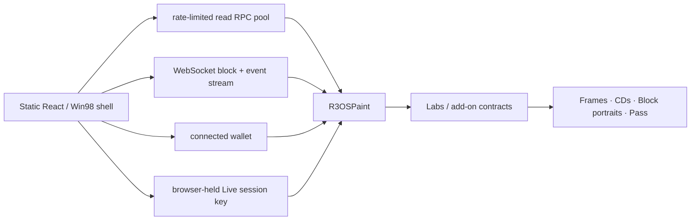

<p align="center">
  
</p>

<h1 align="center">r3OS</h1>

<p align="center">
  <b>An operating system for the world computer, disguised as Windows 98.</b><br>
  One 256 × 256 canvas. Every committed stroke is a Monad transaction.
</p>

<p align="center">
  <a href="#judge-path"><b>60-second path</b></a> ·
  <a href="#run-it-locally"><b>Run locally</b></a> ·
  <a href="docs/TECHNICAL.md"><b>Technical reference</b></a> ·
  <a href="THREAT_MODEL.md"><b>Threat model</b></a>
</p>

<p align="center">
  Monad Metropolis Hackathon · <b>Social, Attention &amp; Culture</b> · solo build by <b>dreiki</b>
</p>

---

## What this is

r3OS boots into a Windows 98-style desktop wrapped around one shared **256 × 256, 16-colour canvas on Monad**. Anyone can watch the canvas and explore the system without a wallet. Connect only when you want to write onchain.

Paint is the center of the project: draw locally, commit pixels as a transaction, watch other painters' live onchain strokes appear and reconcile, then save a moment of the shared canvas as an immutable frame NFT. Frames can become mix CDs, finales can enter a candle auction, and Block Camera turns the block itself into an onchain artifact.

There is **no app backend or database**. The frontend is static and reads contracts, logs and block data directly from Monad RPCs.

**Naming:** `r3OS` is the product and interface. The already-deployed snapshot-28 testnet suite keeps its historical `R3tards*` contract names and `r3tards paint` EIP-712 domain. The fresh mainnet source uses `R3OS*`, `r3OS paint`, `r3OS painter pass` and `r3OS labs`. The actual **r3tards** NFT collection keeps its real collection name and remains the primary holder-integration surface.

A few internal deterministic storage/hash salts still contain historical `r3tards.*` strings on purpose. They are protocol layout keys, not public branding; Phase 7.5 leaves those derivations unchanged while rebranding product-facing contracts and metadata.

### Hackathon thesis

> **Monad is fast enough that fully onchain creative interaction can feel continuous instead of transaction-by-transaction.**

Live Mode is the clearest demonstration. The owner authorizes a browser-held paint session key once; after that, strokes are signed locally and broadcast without a wallet popup per stroke. Receipt logs update the UI immediately after inclusion, then canonical chain reconciliation follows in the background. On Monad, a receipt or standard WebSocket log may still describe a proposed block; X-ray shows commitment-state progression separately when the RPC exposes it.

## Judge path

A wallet is not required for the first impression.

1. Let the boot screen finish. It is doing real work: network discovery, canvas state, program code and shared caches are warmed before the desktop appears.
2. Open **Paint**. The Live strip shows the shared canvas, recent activity and whether live strokes are arriving over the websocket path.
3. Connect only when you want to write, then press **Start Live Mode**. After the one-time session setup, draw again: each stroke is locally signed and sent without another wallet popup.
4. Watch the proof in the same Paint window: your block/receipt, remote strokes from other browsers, **X-ray**, and direct explorer links.
5. Open **DXDIAG.EXE → Performance** for local signing, broadcast, receipt, UI-settle and remote websocket-to-canvas measurements. No telemetry is uploaded.
6. Open **Explore Monad**, then save a frame / burn a CD if you want the wider OS tour.

The exact two-browser recording path is in [`docs/LIVE_DEMO.md`](docs/LIVE_DEMO.md).

## What is onchain

| Surface | What it proves |
| --- | --- |
| **Paint** | One shared 256 × 256 canvas with pixel budgets, seasons, protected outlines and deterministic DF1 glitches. |
| **Live Mode** | Browser-local session signing makes repeated onchain creative actions feel continuous. The burner is capped at **1 MON** and can be ended/swept. |
| **Frames** | Immutable snapshots of the canvas, including season/block context and the recorded `block.coinbase` provenance address. |
| **CD Burner + CD-ROM** | 1–12 owned frames become one immutable Labs CD NFT, then play back as picture tracks from contract data. Source frames are not burned. |
| **Painter Pass** | Free soulbound onchain identity that records participation through stamps. |
| **Quests** | Contract-checked achievements. No token, points economy or offchain scoring service. |
| **Finale Auction** | Season finales use a candle auction whose hidden end is resolved after bidding closes. |
| **Block Camera** | Mints a portrait from the block the capture transaction lands in. |
| **Explore Monad** | Live block timing, MIP-8 storage-page experiments, chain/device information and read-only routing research. |
| **DXDIAG.EXE** | Local-only proof of boot readiness, program responsiveness, RPC method counts and transaction timings. |

### Mainnet holder budgets

The planned launch configuration keeps participation open while giving collection holders extra daily room:

| Holder state | Extra Paint budget | Accounting |
| --- | ---: | --- |
| No supported NFT | none | ordinary hourly budget only |
| **r3tards** | **+512 px/day per owned token** | quota follows the token id, so transfers do not reset that token's daily spend |
| **Skrumpeys** | **+128 px/day** | once per current-holder wallet on Monad mainnet |
| **Monad Cards** | **+128 px/day** | once per current-holder wallet on Monad mainnet |

Skrumpeys (`0xb0dad798c80e40dd6b8e8545074c6a5b7b97d2c0`) and Monad Cards (`0x0000CA12D5c07085022eBC74867157449919Fd67`) are checked directly by the Paint contract with a gas-capped `balanceOf` probe. Their bonuses are intentionally smaller than r3tards, stack with each other, and are disabled off chain 143. The transaction hot path does not touch either external collection unless ordinary hourly + r3tards quota is insufficient; a failed optional probe simply grants no partner bonus.

## Why Monad

The canvas does not need a blockchain merely to store pixels. It needs one where those writes can become an interaction loop.

- **Fast blocks:** proposed/live paint events can propagate while people are still drawing, rather than turning the canvas into a turn-based app; canonical reconciliation corrects speculative state if needed.
- **Many independent writes:** the canvas is split into 16 regions so unrelated paints do not all fight over one storage location.
- **MIP-8 page storage:** the project has explicit experiments showing the effect of warming a 4 KiB storage page.
- **Block / staking context:** saved frames retain `block.coinbase` provenance; Block Camera also reads proposer/epoch data from Monad hardware interfaces when available.
- **Monad gas accounting:** transaction gas limits are deliberately tight because Monad charges against the submitted limit.

The app keeps an ordinary read lane separate from its low-latency action lane. Live Mode signs one raw transaction locally and can send that same serialized transaction to multiple action RPCs; the fastest acceptance wins. It is redundancy for one transaction, not multiple blockchain transactions.

### Live proof surface

The demo deliberately separates what the browser actually measured instead of collapsing everything into one magical "finality" number:

- **Paint** shows receipt inclusion, block, direct explorer link and fresh live strokes from another wallet/browser.
- **Monad X-ray** shows the transaction hash, receipt inclusion, signer path, gas and Monad `Proposed` / `Voted` / `Finalized` states from a shared boot-time `monadLogs` feed when the RPC exposes it. A receipt is not silently renamed `Finalized`.
- **DXDIAG** keeps local signing, broadcast, receipt, receipt-to-UI settle, websocket-event-to-store and store-to-render timings. Nothing is uploaded.

That distinction matters to the thesis: the claim is that the **onchain interaction loop feels continuous**, and the repository exposes the measurements used to support it.

## Architecture



A few implementation choices matter to the user experience:

- boot prefetch shares promises/caches with the programs that later consume them;
- launch-critical program chunks are resolved before the desktop appears;
- receipt logs are applied immediately after inclusion instead of waiting for a lagging RPC index;
- background reconciliation still restores canonical chain state;
- historical/heavy art reads are bounded instead of preloading the entire collection;
- wallet-facing chain metadata uses only `VITE_WALLET_RPC_URL`; internal RPC endpoints are never shown by DXDIAG.

The currently active UI is intentionally smaller than the set of contracts deployed during development. Retired experiments remain documented where they matter to immutable history or active backend dependencies, but their direct UI programs are removed from the production program registry and bundle.

## Current testnet

| | |
| --- | --- |
| Chain | Monad Testnet (`10143`) |
| Paint | [`0x032D5e1591DA2919A4aa5D24Ee9278bFE5F1CdA1`](https://testnet.monadvision.com/address/0x032D5e1591DA2919A4aa5D24Ee9278bFE5F1CdA1) |
| r3tards mock | [`0x6F375D9DA0053A6fA80EC8bb09798B72468FD120`](https://testnet.monadvision.com/address/0x6F375D9DA0053A6fA80EC8bb09798B72468FD120) |
| Painter Pass | [`0x9C2d367A0B7BaFC8d4fAaa4920D9543b42ae218a`](https://testnet.monadvision.com/address/0x9C2d367A0B7BaFC8d4fAaa4920D9543b42ae218a) |
| Core deploy block | `67823235` |
| Mainnet | **Not deployed yet** |

Add-on addresses are discovered from the Paint registry at runtime. Mainnet will be the first deployment of the current Paint configuration.

## Run it locally

Requirements: **Node 22**. Foundry is only required for Solidity build/tests.

```bash
npm ci
cp .env.example .env.local
npm run dev
```

`.env.example` already contains the current **public Monad testnet** configuration, so a reviewer can boot the app without hunting for addresses or private credentials.

Frontend gate:

```bash
npm run check:web
```

Full repository gate:

```bash
npm run check
```

Useful individual commands:

```bash
npm run repo:doctor   # stale files, broken local docs links, README placeholders, retired UI reachability
npm run test:web      # Vitest
npm run build         # TypeScript + Vite production build
npm run generated:check # generated outline + ABI must match source
RPC_URL="$MONAD_TESTNET_RPC_URL" npm run -s launch:doctor -- --paint <address> --expected-chain 10143
```

## Repository map

```text
contracts/src   Solidity contracts and libraries
contracts/test  Foundry tests
src/os          boot, desktop shell, program registry, windows, taskbar, Help
src/paint       shared canvas and local drawing
src/live        burner/session state, signing and Live Mode queues
src/frames      Frames and Labs folder
src/pass        Painter Pass and hardware profiles
src/cdrom       CD-ROM playback
src/labs        active Lab-facing programs
src/monadhw     Explore Monad and Block Camera
src/network     Network Neighborhood / block provenance
src/diagnostics DXDIAG.EXE
src/chain       RPC clients, batching, wallet, transactions, receipts, logs
scripts         repo/launch checks and generated-source tooling
docs            technical reference, deployment and security material
```

## Security

The contracts are **not professionally audited**. The internal AI-assisted review, remaining findings and launch decisions are documented in [`docs/SECURITY_AUDIT_2026-10-02.md`](docs/SECURITY_AUDIT_2026-10-02.md) and [`THREAT_MODEL.md`](THREAT_MODEL.md).

Browser security matters because Live Mode intentionally holds an EOA key locally. The balance is therefore capped at 1 MON; session authorization is scoped and expiring; the app does not expose private keys, RPC URLs or secrets through diagnostics.

## Status

- Monad testnet engineering build is active.
- Performance / boot-prefetch work is complete and measured locally in DXDIAG.
- Cold-user / judge-path and repository-hygiene work is complete.
- Live Mode hero UI, one-flow wallet handoff, two-browser remote proof, explorer/X-ray proof and demo choreography are implemented and validated on testnet.
- Phase 7 is complete. Next is mainnet rehearsal, real community activity, final metrics, recording and submission.

## Credits

Built solo by **dreiki**, with Claude and ChatGPT used as coding assistants. Art, palette and r3tards characters by dreiki.
