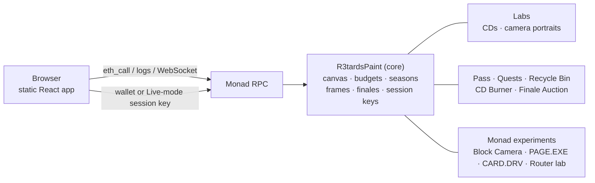

<p align="center">
  
</p>

<h1 align="center">r3tardOS</h1>

<p align="center">
  <b>A Windows 98 computer that lives on Monad, where a whole community paints one canvas together.</b><br>
  Every stroke is a Monad transaction. No server anywhere.
</p>

<p align="center">
  <a href="LIVE_APP_URL"><b>Live app</b></a> ·
  <a href="DEMO_VIDEO_URL"><b>Demo video (3 min)</b></a> ·
  <a href="#run-it-locally"><b>Run it locally</b></a> ·
  <a href="docs/TECHNICAL.md"><b>Technical reference</b></a>
</p>

<p align="center">
  Monad Metropolis Hackathon · <b>Social, Attention &amp; Culture</b> · solo build by <b>dreiki</b> (Buenos Aires)
</p>

---

## What it is

r3tardOS boots like a 1998 PC and opens on one shared **256 × 256, 16-colour canvas** that the r3tards community paints together onchain. You draw with Win98 tools, press Paint, and the status bar says *"painted in block #N · receipt in 0.6 s"*.

You're never painting alone. A "painting now" panel shows who else is here, and other people's strokes flash on your canvas as they land. If you're in another program when someone paints, a **"You've Got Paint"** balloon tells you, and *Open Paint* outlines exactly where.

You can keep a piece of it, too:
- save the canvas as a **frame NFT**;
- burn up to 12 frames onto a **mix CD**;
- play it back in the **CD-ROM drive** as `TRACK01.BMP`, straight from the contract.

At the end of each season, the community's canvas becomes a finale NFT sold in a snipe-proof **candle auction**.

No backend, no token, no points. The canvas, the art, the badges and the auction all live in and are rendered by smart contracts. The site is a static page that reads the chain.

## Try it in 60 seconds

1. Open the **[live app](LIVE_APP_URL)**. The BIOS screen prints the real chain, the latest block and the block time measured in your browser.
2. Click **Paint together**. Watch the canvas and the *painting now* panel; strokes by others flash as they land.
3. Connect any browser wallet with a little MON. Draw, press **Paint**, and see which block it landed in.
4. Turn on **Live mode** (File › Live mode (no wallet popups)…). After two wallet prompts, you paint with no popups for about 2 hours.
5. **File › Save frame…**, then in **My Frames** press **Burn CD** and play it in **CD-ROM (D:)**.

No wallet? You can still draw, watch the canvas live, browse frames and CDs, and explore the desktop.

## Features

| | |
| --- | --- |
| **Paint together** | One shared canvas. Hourly pixel budgets grow with every day you paint. Blank or still-wet pixels are cheap, painting over dry art costs double, and busy 16 × 16 tiles heat up and refuse paint for a while, so nobody can wipe it. |
| **Live presence** | "Painting now" (wallets in the last few minutes), this season's paints and frames, and the latest strokes (click to jump). Others' strokes flash on your canvas. You've Got Paint balloons and a painter count in the tray. All read from the contract's own events. |
| **Live mode** | EIP-712 session key held in the browser. It can only paint and claim quests, expires in ~2 hours, holds at most 10 MON, and leftovers can be swept back. |
| **Frames → CD → CD-ROM** | Frames store their pixels onchain and record the validator that sealed the block. Burn 1–12 frames onto a CD NFT with an onchain disc and track list; the CD-ROM drive plays it back. Unwanted frames go to the Recycle Bin. |
| **Seasons and finale** | 30-day seasons, each with an optional character outline that can't be painted over. The final canvas becomes a finale NFT, sold in a candle auction: ~a day of bidding, and the real end is a random block in the last hour, picked after bidding closes. Anyone can settle. |
| **My Pass** | Free, soulbound, one per wallet. Its onchain picture fills with stamps for what you've done. |
| **Quests** | 8 goals checked against the contracts. Badges grant nothing: no token, no points, no farming. |
| **Block Camera** | A photo booth that mints a small onchain portrait of the block your transaction lands in (validator, epoch, parent hash). |
| **The 1998 layer** | BIOS boot with live chain data, Display Properties with the live canvas as your wallpaper, a canvas screensaver, Save to Floppy (a real 4-bit `.BMP` built from contract bytes), and "Listen", which turns each new block into a note. |
| **Explore Monad** | A side window: watch blocks arrive, measured in your browser, plus a few chain experiments. |

## Why Monad

The one thing the product needs is speed. With 12-second blocks a shared canvas feels turn-based; with Monad's sub-second blocks it feels like a room full of people.

| What you see | What it relies on |
| --- | --- |
| Strokes land in about a second; other people's strokes appear as they land | ~0.4 s blocks. This is the load-bearing reason for Monad. |
| Live mode: sign once, then paint continuously | Per-stroke transactions cheap enough to send from a paint-only session key |
| Block Camera portraits; frames record their validator | Proposer and epoch from Monad's staking precompile |
| Many painters at once without fighting over the same state | The canvas is stored as 16 independent 64 × 64 regions, so paints in different areas touch different storage and suit Monad's parallel execution |

Engineering details we use but don't claim as reasons: the 128 KB contract-size limit (the core is ~50 KB), gas charged on the limit (the app sets tight limits), and EIP-2935 block-hash history (the auction's random end).

## How it works



- **Everything visual is generated onchain** as SVG with embedded BMP pixels: frames, CD discs, the Pass, camera portraits.
- **The frontend is static** (React 19, Vite, viem). It is public-RPC safe: rate-limited, no wide log scans, and the presence panel does one small bounded look-back on load before following live events.
- **The core is frozen.** New features plug in through the Labs, renderer and stamp-source registries, without touching the canvas contract.

## Contracts

| Contract | What it does | Monad testnet |
| --- | --- | --- |
| `R3tardsPaint` | Core: canvas, budgets, seasons, frames, finales, session keys | `0xC9300a14EcdB1296ade8795073Ab97A813ae8cB4` |
| `R3tardsLabs` | CDs and camera portraits (ERC-721) | see deploy log |
| `R3tardsPainterPass` | Soulbound Pass with onchain stamps | see deploy log |
| `R3tardsQuests` | Quest checks against the contracts | see deploy log |
| `R3tardsFinaleAuction` | Candle auction for season finales | see deploy log |
| `R3tardsCDBurner` / `R3tardsRecycleBin` | Burn frames onto CDs / burn frames forever | see deploy log |
| `R3tardsBlockCamera` | Block portraits from Monad block and staking data | see deploy log |

Mainnet addresses: MAINNET_ADDRESSES (added at launch). Source: [`contracts/src`](contracts/src).

## Security

- **Not professionally audited.** An internal review (AI-assisted) found no Critical, High or Medium issues in the contracts; Low findings are documented with a decision for each in [`docs/SECURITY_AUDIT_2026-10-02.md`](docs/SECURITY_AUDIT_2026-10-02.md).
- The site sends a strict Content Security Policy (no inline scripts, no framing), which protects the browser-held Live-mode key.
- Session keys can only paint and claim quests; they can't move funds or mint.
- Owner powers and hard limits: [`THREAT_MODEL.md`](THREAT_MODEL.md).
- Finale auction proceeds go to the project Safe; the r3tards community decides how they are spent.

## Run it locally

Requirements: Node 22, [Foundry](https://getfoundry.sh).

```bash
npm ci
cp .env.example .env.local   # set VITE_CHAIN_ID, VITE_RPC_URL(S) and VITE_PAINT_ADDRESS
npm run dev                  # http://localhost:5173
```

Full check (contracts, web tests, generated files, build):

```bash
npm run check
```

That runs 325 Foundry tests (under Monad's 128 KB contract limit) and 475 frontend tests, regenerates the outline and ABI, and builds the site. Deployment without raw private keys, testnet and mainnet steps: [`docs/TECHNICAL.md`](docs/TECHNICAL.md), [`docs/TESTNET_DEPLOY.md`](docs/TESTNET_DEPLOY.md), [`docs/PRE_MAINNET_CHECKLIST.md`](docs/PRE_MAINNET_CHECKLIST.md).

### Repository layout

```
contracts/src     Solidity: core canvas, Labs, Pass, Quests, auction, Monad experiments
contracts/test    Foundry tests
src/os            the Win98 shell: windows, desktop, Start menu, boot, tray, wallpaper, screensaver
src/paint         Paint, canvas store, live presence
src/frames        My Frames, CD burning
src/cdrom         CD-ROM (D:)
src/monadhw       Explore Monad, Block Camera
src/chain         RPC clients, wallet, transactions, logs
scripts           ABI/outline export, Launch Doctor, contract-size check
docs              technical reference, security review, deploy guides
```

## Status

- **Live on Monad testnet** since October 1, 2026.
- **Mainnet:** MAINNET_STATUS.
- **Community so far:** COMMUNITY_NUMBERS (painters, paints, frames, CDs; not counting the builder's wallets).
- **Known limits:** painting needs a wallet and a little MON (no email login or sponsored gas yet). The desktop is best on a computer; phones work with full-screen windows.

## Credits

Built solo by **dreiki** for and with the **r3tards** community, using Claude and ChatGPT as coding assistants. Art, palette and the r3tards characters by dreiki.

*r3tards is not a r3al proj3ct.*
