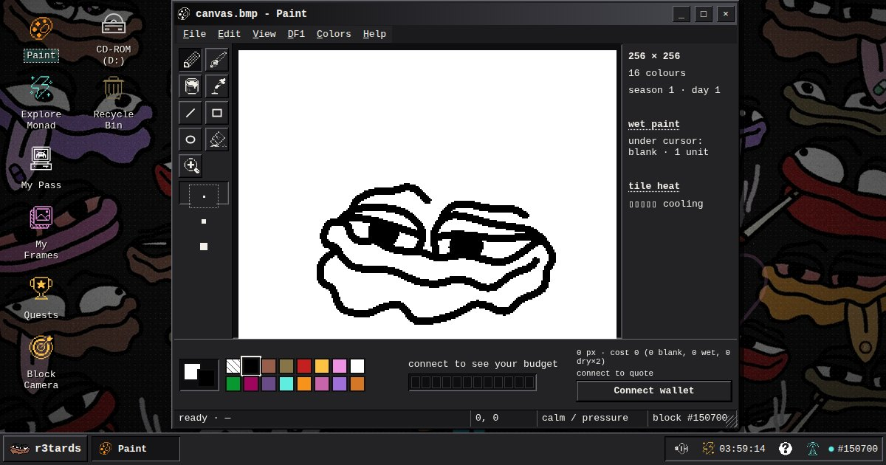
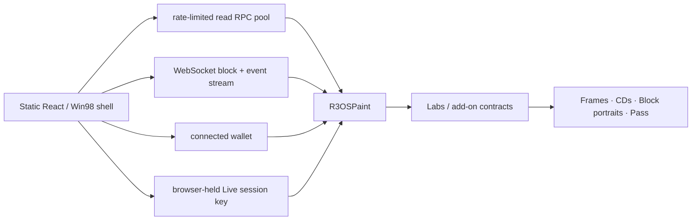

<p align="center">
  
</p>

<h1 align="center">r3OS</h1>

<p align="center">
  <b>A Windows 98 computer on Monad where a whole community paints one canvas together, live.</b><br>
  Every stroke is a Monad transaction. No app-owned state server or database.
</p>

<p align="center">
  <a href="https://r3os.app/"><b>▶ Live app: r3os.app</b></a> ·
  <a href="#try-it-as-a-judge"><b>Judge path</b></a> ·
  <a href="#community"><b>Community</b></a> ·
  <a href="#mainnet"><b>Mainnet contracts</b></a> ·
  <a href="#run-it-locally"><b>Run locally</b></a> ·
  <a href="docs/TECHNICAL.md"><b>Technical reference</b></a> ·
  <a href="docs/submission/MAINNET_EVIDENCE.md"><b>Verified launch evidence</b></a>
</p>

<p align="center">
  Monad Metropolis Hackathon · <b>Social, Attention &amp; Culture</b> · solo build by <b>dreiki</b> · <b>live on Monad mainnet since October 6, 2026</b>
</p>

---

## What it is

r3OS boots like a 1998 PC and opens on one shared **256 × 256, 16-colour canvas** that a community paints together on Monad. You draw with Win98 tools, press Paint, and your stroke lands in the next block, about a second later.

**You're never painting alone.** Paint shows how many wallets are painting right now and their latest strokes. Other people's strokes flash on your canvas as they land. If you're in another program, a **"You've got paint"** note tells you, and *Open Paint* outlines exactly where.

**You can keep a piece of it.** Save the canvas as a **frame NFT**, burn up to 12 frames onto a **mix CD**, and play it back in the **CD-ROM drive**, straight from contract data. Each 30-day season ends with the community's canvas sold in a snipe-proof **candle auction**.

**It belongs to the people painting it.** Built by and for the **r3tards** community, with extra paint for Skrumpeys and Monad Card holders. Your **Painter Pass** fills with stamps for what you did. Badges grant nothing: no token, no points, no farming. Attention turns into a shared artwork and its history.

Anyone can watch without a wallet. Painting needs a wallet, or **Live Mode**: sign once, then paint with no popups.

## Try it as a judge

Open **[r3os.app](https://r3os.app/)** and choose **Run → `demo.exe`** (or go straight to [r3os.app/#/demo](https://r3os.app/#/demo)). It walks through the real programs in seven steps and never signs or fakes anything:

1. **One canvas, everyone:** what r3OS is.
2. **Who's here:** open Paint without a wallet and see who painted recently; click a stroke to jump to it.
3. **Paint together:** open the observer link in a second browser profile, paint here, and watch the stroke appear there about a second later.
4. **Keep a piece of it:** frames, a mix CD, and the CD-ROM drive playing it back.
5. **Live on Monad:** Monad X-ray shows your real transaction going Proposed → Voted → Finalized.
6. **Made by a community:** Season Replay plays back every paint of the season, painter by painter.
7. **The idea underneath:** why the chain can sit inside the interaction loop.

**Judges:** the private part of the submission has a guest-wallet link. It opens r3os.app with a throwaway wallet holding a little MON, so you can paint on mainnet immediately, with no wallet setup and no popups.

## Community

<!-- Season Replay GIF: node scripts/export-replay.mjs && node scripts/replay-gif.mjs, then add:
<p align="center"></p>
-->

<!-- Paste the output of: node scripts/community-stats.mjs --exclude <builder wallets> -->

Numbers are counted from the contracts' own events by [`scripts/community-stats.mjs`](scripts/community-stats.mjs), not counting the builder's wallets. Anyone can rerun it against mainnet.

### Holder bonuses

| Holder state | Extra Paint budget | Accounting |
| --- | ---: | --- |
| No supported NFT | none | ordinary hourly budget only |
| **r3tards** | **+512 px/day per owned token** | quota follows the token id, so transfers do not reset that token's daily spend |
| **Skrumpeys** | **+128 px/day** | once per current-holder wallet on Monad mainnet |
| **Monad Cards** | **+128 px/day** | once per current-holder wallet on Monad mainnet |

## What you can do

| | |
| --- | --- |
| **Paint together** | Hourly pixel budgets that grow with every day you paint. Blank or still-wet pixels are cheap, painting over dry art costs double, and busy 16 × 16 tiles heat up and refuse paint for a while, so nobody can wipe the canvas. |
| **Season Replay** | Watch the whole season being made: every paint, in order, rebuilt from the contract's `Painted` events with [`scripts/export-replay.mjs`](scripts/export-replay.mjs). Play, scrub, every-stroke or real-time. |
| **See each other** | "Painting now", the latest strokes, strokes flashing as they land, "You've got paint" notes and a painter count in the taskbar. All read from `Painted` events. |
| **Paint parties on a big screen** | [r3os.app/#/tv](https://r3os.app/#/tv) (or Run → `tv`) puts the canvas full-screen for a projector or stream: every stroke flashes where it lands with who painted it, "painting right now", tonight's totals and top painters, a rotating paint prompt and a QR code to join. Read-only, from the same contract events. |
| **Live Mode** | A browser-held session key authorized once. It can only paint and claim quests, expires, holds at most **1 MON**, and can be ended and swept back. |
| **Frames → CD → CD-ROM** | Frames store their pixels onchain and record the block's `block.coinbase`. 1–12 frames become one CD NFT that the CD-ROM drive plays back. Source frames are never touched. |
| **Seasons and finale** | 30-day seasons with an optional protected character outline. The final canvas becomes a finale NFT sold in a candle auction whose real end is picked after bidding closes. Proceeds go to the project wallet ([`0x40Ea…647fA`](https://monadvision.com/address/0x40Ea55E0b8f02f8eBc9D91e082e202ed988647fA)); the community decides how they are spent. |
| **Painter Pass and Quests** | A free soulbound Pass with onchain stamps, and quests checked directly against the contracts. |
| **Block Camera** | Mints a portrait of the block your transaction lands in. |
| **The 1998 layer** | BIOS boot with live chain data, the live canvas as your wallpaper, a canvas screensaver, Save to Floppy (a real `.BMP` from contract bytes), and Listen, which turns blocks into notes. |

## Why Monad

A shared canvas on a 12-second chain is turn-based. On Monad it feels like a room full of people, and that is the whole point of the project.

| What you see | What it relies on |
| --- | --- |
| Your stroke lands in about a second, and other people's strokes appear while you're still drawing | Monad's ~0.4 s blocks. This is the load-bearing reason. |
| Live Mode: one approval, then continuous painting | Per-stroke transactions cheap enough to send from a paint-only session key |
| X-ray shows Proposed → Voted → Finalized for your own stroke | Monad's commitment stages, read from `monadLogs` and kept separate from receipt inclusion |
| Many people painting at once | The canvas is stored as 16 independent regions, so unrelated paints don't fight over the same storage |
| Block Camera portraits; frames that record their block producer | Monad block and staking data |

The idea underneath: r3OS puts the chain where apps normally put their servers, databases and realtime services. On Monad that's fast enough to sit inside the interaction loop. **Explore Monad** has the storage-page and block experiments behind that claim, and **DXDIAG** shows local timings (nothing is uploaded).

## How it works



- Everything visual is generated onchain as SVG with embedded BMP pixels: frames, CDs, the Pass, camera portraits.
- The frontend is static. Canonical application state is held in Monad contracts and events, not an app-owned database or state server. Reads normally use Monad RPCs; an optional stateless read-accelerator proxy can speed up the first screen, with direct public RPC fallback. If enabled, this proxy is network infrastructure, not a source of app truth.
- Receipt logs update the canvas right away; background reconciliation keeps it matched to canonical chain state.

## Mainnet

Live on Monad mainnet (`chainId 143`) since **October 6, 2026, 11:00 UTC** at **[r3os.app](https://r3os.app/)**. All 16 contracts are deployed.

| Contract | Mainnet address / explorer |
| --- | --- |
| R3OSPaint | [`0x5102de3817ae16b3afaeb9d180130669a70787b3`](https://monadvision.com/address/0x5102de3817ae16b3afaeb9d180130669a70787b3) |
| R3OSLabs | [`0xe6b3b17e3b1827fe02183f496e84331ebe74751c`](https://monadvision.com/address/0xe6b3b17e3b1827fe02183f496e84331ebe74751c) |
| DiffRenderer | [`0x5d2dcd25d5e847770f6e8a7bfbdf1df4f6e454f7`](https://monadvision.com/address/0x5d2dcd25d5e847770f6e8a7bfbdf1df4f6e454f7) |
| SeasonTimelapseRenderer | [`0x8c91d7a829569ebf1dfc671f6cf328911813b78d`](https://monadvision.com/address/0x8c91d7a829569ebf1dfc671f6cf328911813b78d) |
| DF1Renderer | [`0x6ec2027e5b2493f2ecc5882bece14b31197c3ce0`](https://monadvision.com/address/0x6ec2027e5b2493f2ecc5882bece14b31197c3ce0) |
| R3OSPainterPass | [`0xb2d2d7681f451d9c69ed5ef2a0ed0b6b6494f103`](https://monadvision.com/address/0xb2d2d7681f451d9c69ed5ef2a0ed0b6b6494f103) |
| R3OSFinaleAuction | [`0x3d3154db1b32724a82ac9ec3f1811808558b9ef8`](https://monadvision.com/address/0x3d3154db1b32724a82ac9ec3f1811808558b9ef8) |
| R3OSQuests | [`0x4398f022d7700cf5541ac59d2ff83f1a8a30a6f1`](https://monadvision.com/address/0x4398f022d7700cf5541ac59d2ff83f1a8a30a6f1) |
| R3OSRecycleBin | [`0x02234e30dac8bed319f30fb1ec123da8bf71a2eb`](https://monadvision.com/address/0x02234e30dac8bed319f30fb1ec123da8bf71a2eb) |
| R3OSCDBurner | [`0x5556b0ef2ffa3a970c852362ee69313c08f5b1cd`](https://monadvision.com/address/0x5556b0ef2ffa3a970c852362ee69313c08f5b1cd) |
| R3OSCardMemory | [`0x3D871B434736939748ea1BD08C06c1E8750506ec`](https://monadvision.com/address/0x3D871B434736939748ea1BD08C06c1E8750506ec) |
| R3OSPageExe | [`0xD6182F6F25006f506A0bedC38E6a7C6B02cE15Bb`](https://monadvision.com/address/0xD6182F6F25006f506A0bedC38E6a7C6B02cE15Bb) |
| R3OSBlockCamera | [`0x1f3d264f0bEf5deDdbf5e92b2A5C0AA0c8c6c430`](https://monadvision.com/address/0x1f3d264f0bEf5deDdbf5e92b2A5C0AA0c8c6c430) |
| R3OSOperatorRecord | [`0xEd7c82243C63eB1Cf51E1210f7846b4EC8725A6E`](https://monadvision.com/address/0xEd7c82243C63eB1Cf51E1210f7846b4EC8725A6E) |
| R3OSSystemEvent | [`0xB93A2b18437A1f169D39D81aAD19b074D6292066`](https://monadvision.com/address/0xB93A2b18437A1f169D39D81aAD19b074D6292066) |
| R3OSRouterLab | [`0x1206cD64b805fA612C49DC0296c8813248428661`](https://monadvision.com/address/0x1206cD64b805fA612C49DC0296c8813248428661) |

How the deployment was checked (a real canary paint observed Proposed → Voted → Finalized, finalized launch checks, reproducible evidence hashes): [`docs/submission/MAINNET_EVIDENCE.md`](docs/submission/MAINNET_EVIDENCE.md).

**Naming:** r3OS is the product. The historical testnet keeps its `R3tards*` contract names; mainnet uses `R3OS*`. The **r3tards** NFT collection keeps its real name.

## Run it locally

Requirements: **Node 22**. Foundry is only required for Solidity build/tests.

```bash
npm ci
cp .env.example .env.local
npm run dev
```

The supplied `.env.example` intentionally contains **historical public Monad testnet values**, not production values. For a mainnet local run, change `.env.local` to chain `143`, public RPCs `https://rpc.monad.xyz` and `https://rpc2.monad.xyz`, WebSocket `wss://rpc.monad.xyz`, Paint `0x5102de3817ae16b3afaeb9d180130669a70787b3`, wallet RPC `https://rpc.monad.xyz` and explorer `https://monadvision.com`. Clear any old `VITE_RPC_URL`/`VITE_CONTRACT_ADDRESS` overrides and replace the testnet `VITE_DEPLOY_BLOCK` with the **actual** mainnet Paint deployment block from accepted chain evidence before booting. Never place secret RPC credentials or keys in any `VITE_` variable.

Frontend gate:

```bash
npm run check:web
```

Full repository gate:

```bash
npm run check
```

Useful individual commands:

```bash
npm run repo:doctor   # stale/dead files, broken docs links, placeholders, submission-surface checks
npm run test:web      # Vitest
npm run build         # TypeScript + Vite production build
npm run generated:check # generated outline + ABI must match source
RPC_URL="https://rpc.monad.xyz" npm run -s launch:doctor -- --paint 0x5102de3817ae16b3afaeb9d180130669a70787b3 --expected-chain 143
```

## Repository map

```text
contracts/src   Solidity contracts and libraries
contracts/test  Foundry tests
src/os          boot, desktop shell, program registry, windows, taskbar, Help
src/paint       shared canvas and local drawing
src/live        burner/session state, signing and Live Mode queues
src/frames      Frames and Labs folder
src/pass        Painter Pass and hardware profiles
src/cdrom       CD-ROM playback
src/labs        active Lab-facing programs
src/monadhw     Explore Monad and Block Camera
src/network     Network Neighborhood / block provenance
src/diagnostics DXDIAG.EXE
src/chain       RPC clients, batching, wallet, transactions, receipts, logs
scripts         repo/launch checks and generated-source tooling
docs            technical reference, protocol specs and security model
```

## What's next

The contracts are frozen; everything below happens on top of them.

- **Season 1 ends with its finale.** The last canvas becomes the finale NFT, sold in the candle auction. Proceeds go to the project wallet and the community decides what they fund.
- **Paint parties.** Regular sessions with the broadcast view on a big screen and a new prompt list each time, so the canvas keeps getting new painters and the same ones keep coming back.
- **Every season gets its replay.** `scripts/export-replay.mjs` publishes the full stroke history at the end of each season, so the whole history stays watchable.
- **Season 2 is set by the community.** The outline, the face and the prompts for the next 30 days come from the people who painted this one.

## Security

The contracts are **not professionally audited**. See [`THREAT_MODEL.md`](THREAT_MODEL.md) for owner powers, trust boundaries and the Live Mode limits. Live Mode keeps a key in the browser on purpose, so it is capped at 1 MON, scoped to painting and quests, and expires; diagnostics never show keys or RPC URLs.

## Credits

Built solo by **dreiki** for and with the **r3tards** community, using Claude and ChatGPT as coding assistants. Art, palette and r3tards characters by dreiki.
