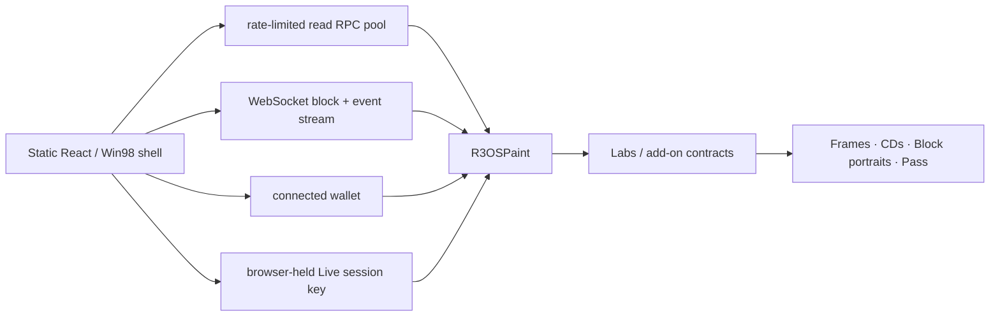

<p align="center">
  
</p>

<h1 align="center">r3OS</h1>

<p align="center">
  <b>An operating system for the world computer.</b><br>
  A 256 × 256 shared canvas on Monad, where the blockchain participates in the interaction loop.
</p>

<p align="center">
  <a href="#judge-path"><b>Judge path</b></a> ·
  <a href="#mainnet-deployment"><b>Mainnet contracts</b></a> ·
  <a href="#run-it-locally"><b>Run locally</b></a> ·
  <a href="docs/TECHNICAL.md"><b>Technical reference</b></a> ·
  <a href="THREAT_MODEL.md"><b>Threat model</b></a>
</p>

<p align="center">
  Monad Metropolis Hackathon · <b>Social, Attention &amp; Culture</b> · solo build by <b>dreiki</b>
</p>

---

## What this is

r3OS is an operating system for the world computer: a Windows 98-style desktop exploring what applications look like when **Monad itself is fast enough to participate directly in the interaction loop**. Its signature program is one shared **256 × 256, 16-colour onchain canvas**. Anyone can observe without a wallet; writing requires a wallet or an authorized Live Mode session.

Paint is the center of the project: draw locally, commit pixels as a transaction, watch other painters' live onchain strokes appear and reconcile, then save a moment of the shared canvas as an immutable frame NFT. Frames can become mix CDs, finales can enter a candle auction, and Block Camera turns the block itself into an onchain artifact.

Core state and application logic do not depend on an app-owned backend or database. The frontend is static and reads contracts, logs and block data directly from Monad RPCs; optional third-party discovery services may enrich NFT discovery without becoming protocol state.

On mainnet, r3OS can optionally use a **stateless FastLane read accelerator** behind a Cloudflare Worker for the bounded startup Boot Packet. It stores no canonical state and signs nothing; direct public Monad RPC/WebSocket remains the fallback and correctness path if the Worker is unavailable.

**Naming:** `r3OS` is the product and interface. The historical testnet deployment keeps its deployed `R3tards*` contract names and `r3tards paint` EIP-712 domain for compatibility. Current mainnet source uses `R3OS*`, `r3OS paint`, `r3OS painter pass` and `r3OS labs`. The actual **r3tards** NFT collection keeps its real collection name and remains the primary holder-integration surface.

A few deterministic storage/hash salts still contain historical `r3tards.*` strings on purpose. They are protocol layout keys, not public branding, and remain unchanged to preserve deterministic derivations.

### Hackathon thesis

> **r3OS deliberately places blockchain operations where conventional applications normally put local servers, databases, real-time services, and application backends.**
>
> The hypothesis is not just that Monad settles transactions quickly. It is that the chain can participate directly in the application interaction loop.

Live Mode is the clearest demonstration. The owner authorizes a browser-held paint session key once; after that, strokes are signed locally and broadcast without a wallet popup per stroke. Receipt logs update the UI immediately after inclusion, then canonical chain reconciliation follows in the background. On Monad, a receipt or standard WebSocket log may still describe a proposed block; X-ray shows commitment-state progression separately when the RPC exposes it.

## Judge path

**Start without a wallet.** Launch the guide with **Run → `demo.exe`** (or `#/demo`). The guide organizes the existing programs; it does not simulate data, sign transactions or perform any chain writes.

1. **Thesis:** Read the direct architecture: browser → Monad RPC/WebSocket → contracts/storage/logs. No app-owned canonical backend or database.
2. **Paint:** Open the shared canvas. Observe it without connecting; optionally connect to paint. In Live Mode, a browser-held paint session key is authorized once and signs subsequent strokes locally.
3. **Remote observation:** An independent second browser profile can follow real `Painted` updates. Remote propagation is not finality.
4. **X-Ray:** Inspect the real transaction lifecycle. Local response, protocol observation (`monadLogs`), receipt inclusion and `Finalized` are separate signals.
5. **Explore Monad → Storage race:** Run the **read-only PAGE.EXE / MIP-8** 4 KiB-page comparison. It may or may not show a measurable page discount during a particular run; the interface reports observed results, not a fabricated outcome.
6. **Conclusion:** The desktop is a UI for experimenting with Monad as a world computer, not a Windows clone or a blockchain-powered screenshot gallery.

The guide and its observable status indicators do **not** bypass wallet approvals or cause transactions. See **DXDIAG.EXE** for optional local-only timing details rather than treating its values as network-wide benchmarks.

## What is onchain

| Surface | What it proves |
| --- | --- |
| **Paint** | One shared 256 × 256 canvas with pixel budgets, seasons, protected outlines and deterministic DF1 glitches. |
| **Live Mode** | Browser-local session signing makes repeated onchain creative actions feel continuous. The burner is capped at **1 MON** and can be ended/swept. |
| **Frames** | Immutable snapshots of the canvas, including season/block context and the recorded `block.coinbase` provenance address. |
| **CD Burner + CD-ROM** | 1–12 owned frames become one immutable Labs CD NFT, then play back as picture tracks from contract data. Source frames are not burned. |
| **Painter Pass** | Free soulbound onchain identity that records participation through stamps. |
| **Quests** | Contract-checked achievements. No token, points economy or offchain scoring service. |
| **Finale Auction** | Season finales use a candle auction whose hidden end is resolved after bidding closes. |
| **Block Camera** | Mints a portrait from the block the capture transaction lands in. |
| **Explore Monad** | Live block timing, MIP-8 storage-page experiments, chain/device information and read-only routing research. |
| **DXDIAG.EXE** | Local-only proof of boot readiness, program responsiveness, RPC method counts and transaction timings. |

### Mainnet holder budgets

The planned launch configuration keeps participation open while giving collection holders extra daily room:

| Holder state | Extra Paint budget | Accounting |
| --- | ---: | --- |
| No supported NFT | none | ordinary hourly budget only |
| **r3tards** | **+512 px/day per owned token** | quota follows the token id, so transfers do not reset that token's daily spend |
| **Skrumpeys** | **+128 px/day** | once per current-holder wallet on Monad mainnet |
| **Monad Cards** | **+128 px/day** | once per current-holder wallet on Monad mainnet |

Skrumpeys (`0xb0dad798c80e40dd6b8e8545074c6a5b7b97d2c0`) and Monad Cards (`0x0000CA12D5c07085022eBC74867157449919Fd67`) are checked directly by the Paint contract with a gas-capped `balanceOf` probe. Their bonuses are intentionally smaller than r3tards, stack with each other, and are disabled off chain 143. The transaction hot path does not touch either external collection unless ordinary hourly + r3tards quota is insufficient; a failed optional probe simply grants no partner bonus.

## Why Monad

The canvas does not need a blockchain merely to store pixels. It needs one where those writes can become an interaction loop.

- **Fast blocks:** proposed/live paint events can propagate while people are still drawing, rather than turning the canvas into a turn-based app; canonical reconciliation corrects speculative state if needed.
- **Many independent writes:** the canvas is split into 16 regions so unrelated paints do not all fight over one storage location.
- **MIP-8 page storage:** the project has explicit experiments showing the effect of warming a 4 KiB storage page.
- **Block / staking context:** saved frames retain `block.coinbase` provenance; Block Camera also reads proposer/epoch data from Monad hardware interfaces when available.
- **Monad gas accounting:** transaction gas limits are deliberately tight because Monad charges against the submitted limit.

The app keeps an ordinary read lane separate from its low-latency action lane. Live Mode signs one raw transaction locally and can send that same serialized transaction to multiple action RPCs; the fastest acceptance wins. It is redundancy for one transaction, not multiple blockchain transactions.

### Live proof surface

The demo deliberately separates what the browser actually measured instead of collapsing everything into one magical "finality" number:

- **Paint** shows receipt inclusion, block, direct explorer link and fresh live strokes from another wallet/browser.
- **Monad X-ray** shows the transaction hash, receipt inclusion, signer path, gas and Monad `Proposed` / `Voted` / `Finalized` states from a shared boot-time `monadLogs` feed when the RPC exposes it. A receipt is not silently renamed `Finalized`.
- **DXDIAG** keeps local signing, broadcast, receipt, receipt-to-UI settle, websocket-event-to-store and store-to-render timings. Nothing is uploaded.

That distinction matters to the thesis: the claim is that the **onchain interaction loop feels continuous**, and the repository exposes the measurements used to support it.

## Architecture



A few implementation choices matter to the user experience:

- boot prefetch shares promises/caches with the programs that later consume them;
- launch-critical program chunks are resolved before the desktop appears;
- receipt logs are applied immediately after inclusion instead of waiting for a lagging RPC index;
- background reconciliation still restores canonical chain state;
- historical/heavy art reads are bounded instead of preloading the entire collection;
- wallet-facing chain metadata uses only `VITE_WALLET_RPC_URL`; internal RPC endpoints are never shown by DXDIAG.

The mainnet contract surface is intentionally limited to contracts consumed by the current r3OS product. Discontinued experiments remain available through Git history rather than shipping in source, deployment wiring or generated ABIs. The historical testnet can still contain old registry entries, so a small compatibility policy hides them when the frontend points at that deployment.

## Mainnet deployment

**Deployed and accepted on Monad mainnet (`chainId 143`).** Paint launched October 6, 2026 at 11:00 UTC (season start `1791284400`). The final accepted deployment's contract addresses are fixed; **all 16 contracts are deployed and source verified**.

| Contract | Mainnet address / explorer |
| --- | --- |
| R3OSPaint | [`0x5102de3817ae16b3afaeb9d180130669a70787b3`](https://monadvision.com/address/0x5102de3817ae16b3afaeb9d180130669a70787b3) |
| R3OSLabs | [`0xe6b3b17e3b1827fe02183f496e84331ebe74751c`](https://monadvision.com/address/0xe6b3b17e3b1827fe02183f496e84331ebe74751c) |
| DiffRenderer | [`0x5d2dcd25d5e847770f6e8a7bfbdf1df4f6e454f7`](https://monadvision.com/address/0x5d2dcd25d5e847770f6e8a7bfbdf1df4f6e454f7) |
| SeasonTimelapseRenderer | [`0x8c91d7a829569ebf1dfc671f6cf328911813b78d`](https://monadvision.com/address/0x8c91d7a829569ebf1dfc671f6cf328911813b78d) |
| DF1Renderer | [`0x6ec2027e5b2493f2ecc5882bece14b31197c3ce0`](https://monadvision.com/address/0x6ec2027e5b2493f2ecc5882bece14b31197c3ce0) |
| R3OSPainterPass | [`0xb2d2d7681f451d9c69ed5ef2a0ed0b6b6494f103`](https://monadvision.com/address/0xb2d2d7681f451d9c69ed5ef2a0ed0b6b6494f103) |
| R3OSFinaleAuction | [`0x3d3154db1b32724a82ac9ec3f1811808558b9ef8`](https://monadvision.com/address/0x3d3154db1b32724a82ac9ec3f1811808558b9ef8) |
| R3OSQuests | [`0x4398f022d7700cf5541ac59d2ff83f1a8a30a6f1`](https://monadvision.com/address/0x4398f022d7700cf5541ac59d2ff83f1a8a30a6f1) |
| R3OSRecycleBin | [`0x02234e30dac8bed319f30fb1ec123da8bf71a2eb`](https://monadvision.com/address/0x02234e30dac8bed319f30fb1ec123da8bf71a2eb) |
| R3OSCDBurner | [`0x5556b0ef2ffa3a970c852362ee69313c08f5b1cd`](https://monadvision.com/address/0x5556b0ef2ffa3a970c852362ee69313c08f5b1cd) |
| R3OSCardMemory | [`0x3D871B434736939748ea1BD08C06c1E8750506ec`](https://monadvision.com/address/0x3D871B434736939748ea1BD08C06c1E8750506ec) |
| R3OSPageExe | [`0xD6182F6F25006f506A0bedC38E6a7C6B02cE15Bb`](https://monadvision.com/address/0xD6182F6F25006f506A0bedC38E6a7C6B02cE15Bb) |
| R3OSBlockCamera | [`0x1f3d264f0bEf5deDdbf5e92b2A5C0AA0c8c6c430`](https://monadvision.com/address/0x1f3d264f0bEf5deDdbf5e92b2A5C0AA0c8c6c430) |
| R3OSOperatorRecord | [`0xEd7c82243C63eB1Cf51E1210f7846b4EC8725A6E`](https://monadvision.com/address/0xEd7c82243C63eB1Cf51E1210f7846b4EC8725A6E) |
| R3OSSystemEvent | [`0xB93A2b18437A1f169D39D81aAD19b074D6292066`](https://monadvision.com/address/0xB93A2b18437A1f169D39D81aAD19b074D6292066) |
| R3OSRouterLab | [`0x1206cD64b805fA612C49DC0296c8813248428661`](https://monadvision.com/address/0x1206cD64b805fA612C49DC0296c8813248428661) |

**Permanent/intended mainnet state:** Renderer registry frozen with built-in, Diff, Season Timelapse, and DF1. Experiment registry intentionally **not frozen** to preserve discovery headroom. `R3OSSystemEvent` is armed but **not activated**; its irreversible activation is not part of this demonstration or the genesis marker.

### Proof of mainnet acceptance

- **Accepted source:** `42a17e62140d474d59922bb922599defac39d856` (Phase 9D deployment baseline; subsequent frontend-only changes are separate).
- **Real Paint canary:** [`0x71821fedd32fbacd582d76fbb4a1ddd767e3590f6d779ea6131ad0f96221eb8c`](https://monadvision.com/tx/0x71821fedd32fbacd582d76fbb4a1ddd767e3590f6d779ea6131ad0f96221eb8c), block `111045205`. One real transaction painted pixel `(0,0)` blank → colour 1 → blank. The image returned to its initial state, but accounting and events advanced.
- **Canary checks:** **21 OK / 0 WARN / 0 FAIL**, including a successful receipt, `Painted`, observed `Proposed` → `Voted` → `Finalized` → `Verified`, and matching canonical transaction block evidence from independent providers.
- **Final Launch Doctor:** finalized block `111045783` (hash `0x1a333ec173b4f667ec9d36269b458501b70b446c68744ca31e2998352dada3bd`), **106 OK / 0 WARN / 0 FAIL / 1 UNKNOWN**. The `UNKNOWN` concerns the documented EIP-2935 historical-behaviour/testnet semantic check, not a deployment failure.
- **Accepted local gates:** 502/502 web tests, 241 passing Forge tests, three expected fork skips, plus passing builds, generated check, repo doctor, speculation, torture, and diff check.
- **Deployment-manifest SHA-256:** `0x307580c4fc98f28cee605a5a5bd348f08a9f1eba71788bd26eaced86e0cf67f1`.
- **Canonical genesis evidence:** `R3OS_MAINNET_GENESIS` = `0x6b07e83382d4f06d03620084b2b13205768f8b081e88c27661fee8c2d3a2a137`. This is a SHA-256 over canonical JSON evidence bytes, **not an onchain event**.

Final acceptance evidence is preserved separately from older deployment and recovery journals. The existence of an older incomplete deployment-address artifact must not be mistaken for the finalized v2 deployment evidence.

**Historical testnet:** chain `10143` and the legacy `R3tards*` contracts remain for compatibility and historical reference, not as the production deployment.

## Run it locally

Requirements: **Node 22**. Foundry is only required for Solidity build/tests.

```bash
npm ci
cp .env.example .env.local
npm run dev
```

The supplied `.env.example` intentionally contains **historical public Monad testnet values**, not production values. For a mainnet local run, change `.env.local` to chain `143`, public RPCs `https://rpc.monad.xyz` and `https://rpc2.monad.xyz`, WebSocket `wss://rpc.monad.xyz`, Paint `0x5102de3817ae16b3afaeb9d180130669a70787b3`, wallet RPC `https://rpc.monad.xyz` and explorer `https://monadvision.com`. Clear any old `VITE_RPC_URL`/`VITE_CONTRACT_ADDRESS` overrides and replace the testnet `VITE_DEPLOY_BLOCK` with the **actual** mainnet Paint deployment block from accepted chain evidence before booting. Never place secret RPC credentials or keys in any `VITE_` variable.

Frontend gate:

```bash
npm run check:web
```

Full repository gate:

```bash
npm run check
```

Useful individual commands:

```bash
npm run repo:doctor   # stale/dead files, broken docs links, placeholders, submission-surface checks
npm run test:web      # Vitest
npm run build         # TypeScript + Vite production build
npm run generated:check # generated outline + ABI must match source
RPC_URL="https://rpc.monad.xyz" npm run -s launch:doctor -- --paint 0x5102de3817ae16b3afaeb9d180130669a70787b3 --expected-chain 143
```

## Repository map

```text
contracts/src   Solidity contracts and libraries
contracts/test  Foundry tests
src/os          boot, desktop shell, program registry, windows, taskbar, Help
src/paint       shared canvas and local drawing
src/live        burner/session state, signing and Live Mode queues
src/frames      Frames and Labs folder
src/pass        Painter Pass and hardware profiles
src/cdrom       CD-ROM playback
src/labs        active Lab-facing programs
src/monadhw     Explore Monad and Block Camera
src/network     Network Neighborhood / block provenance
src/diagnostics DXDIAG.EXE
src/chain       RPC clients, batching, wallet, transactions, receipts, logs
scripts         repo/launch checks and generated-source tooling
docs            technical reference, protocol specs and security model
```

## Security

The contracts are **not professionally audited**. The repository includes a maintained [`THREAT_MODEL.md`](THREAT_MODEL.md), security regression tests, static-analysis policy and explicit trust boundaries for external integrations.

Browser security matters because Live Mode intentionally holds an EOA key locally. The balance is therefore capped at 1 MON; session authorization is scoped and expiring; the app does not expose private keys, RPC URLs or secrets through diagnostics.

## Status

- **Production accepted on Monad mainnet** October 6, 2026: 16/16 contracts deployed with matching verified source, renderer registry permanently frozen and experiments intentionally open.
- **Phase 9D passed** with a real canary, multi-provider checks, finalized Launch Doctor, deterministic Flight Recorder evidence and green accepted tests. No further mainnet deployment or irreversible admin action is planned for submission.
- **Phase 9E `demo.exe`** adds a frontend-only judge guide. Its later frontend test counts belong to the subsequent presentation update and must not be retroactively attributed to the accepted deployment commit.
- **Security:** the contracts are not professionally audited. Review the threat model and existing operational/Live Mode limitations rather than treating test counts as an audit.

## Credits

Built solo by **dreiki**, with Claude and ChatGPT used as coding assistants. Art, palette and r3tards characters by dreiki.
